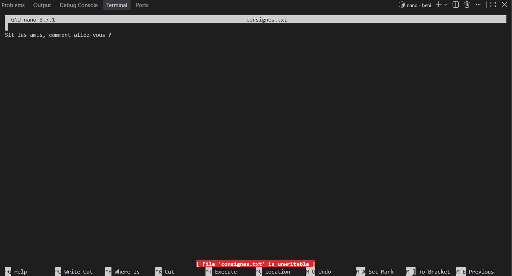

# Commandes de manipulation de fichiers


## Avec la commande `mkdir`
J'ai créé le dossier `exercises`, puis le dossier `entreprises`, et dedans les dossiers `accounting`, `rh` et `computerScience` :

```bash
mkdir -p entreprises/{accounting,rh,computerScience}
```

### Autres astuces avancées avec `mkdir`
```bash
mkdir semaine{1..8}        # crée semaine1 à semaine8 ({1..8} = suite de nombres)
mkdir -p test/a/b/c        # dossiers imbriqués
mkdir -p test/{x,y,z}      # dossiers côte à côte
```


## Avec la commande `touch`
Dans le dossier `computerScience`, j'ai créé les fichiers `.txt` suivants : `development.txt`, `devops.txt` et `ia.txt`.
```bash
touch development.txt devops.txt ia.txt
```

### Autres astuces avancées avec `touch`
```bash
touch rapport_{lundi,mardi,mercredi}.txt  # créer plusieurs fichiers en une seule commande
touch test/.secret                        # un fichier caché (le point au début)
```


## Avec la commande `mv`
J'ai renommé le fichier `ia.txt` en `science_of_ia.txt`, puis, toujours avec `mv`, j'ai déplacé le fichier `devops.txt` dans le dossier `rh` :
```bash
mv ia.txt science_of_ia.txt  # renommer un fichier
mv devops.txt ../rh/         # déplacer un fichier
```

### Autres astuces avancées avec `mv`
```bash
mv rapport.txt ../rh/rapport_2026.txt  # déplacer et renommer en même temps
mv fichier1.txt fichier2.txt ../rh/    # plusieurs fichiers vers un dossier
mv *.txt ../rh/                        # tous les .txt du dossier actuel
```

> [!WARNING]
> `mv` écrase sans prévenir un fichier qui porte déjà le même nom dans la destination.\
> Ajoutez `-i` (*interactive*) pour que `mv` demande confirmation avant d'écraser :

```bash
mv -i rapport.txt ../rh/
```


## Avec la commande `rm`
J'ai supprimé le fichier `development.txt` :
```bash
rm development.txt  # supprimer un fichier
```

### Autres astuces avancées avec `rm`
```bash
rm fichier1.txt fichier2.txt  # supprimer plusieurs fichiers
rm *.log                      # supprimer tous les fichiers .log du dossier
rmdir dossier                 # supprimer un dossier VIDE uniquement
rm -r dossier                 # supprimer un dossier ET tout son contenu (-r = récursif)
```

### Options utiles
> [!TIP]
> `-i`	Demande confirmation pour chaque fichier. C'est la plus sûre.\
> `-I`	Demande une seule confirmation si vous supprimez plus de 3 fichiers ou un dossier. C'est un bon compromis.\
> `-v`	Affiche chaque fichier supprimé (*verbose*). On voit ce qui se passe.\
> `-r`	Supprime les dossiers et leur contenu.\
> `-f`	Force : aucune question, aucun message d'erreur.

### Les astuces de prudence

1. Vérifier avant de supprimer :
   ```bash
   ls *.log  # d'abord, voir ce qui correspond
   rm *.log  # ensuite, supprimer
   ```
2. Supprimer un fichier dont le nom commence par un tiret. Un fichier nommé `-test.txt` est pris pour une option. Ajoutez `--`, qui signifie « fin des options » :
   ```bash
   rm -- -test.txt
   ```
3. Supprimer un fichier dont le nom contient des espaces :
   ```bash
   rm "mon fichier.txt"
   ```

## Les dangers à connaître absolument
> [!CAUTION]
> `rm -rf` supprime tout, sans aucune question. Utilisez-le seulement quand vous êtes certain de la cible, et relisez la commande avant d'appuyer sur Entrée.

```bash
rm -rf ./dossier   # supprime "dossier" ✅
rm -rf . /dossier  # supprime TOUT le dossier actuel ❌ (un espace en trop !)
rm -rf "$DOSSIER"/*  # ❌ si $DOSSIER est vide, la commande devient rm -rf /* : vérifier la variable avant !
```

# Commandes de création d'utilisateurs et de restriction des droits

Pour l'occasion, j'ai créé un dossier `partage` dans le répertoire `/srv`, afin de mettre en pratique les notions de propriétaire et de groupe.
```bash
sudo mkdir /srv/partage
```

Puis j'ai créé dans le dossier `partage` un fichier texte, `consignes.txt`, que j'ai édité avec la commande :
```bash
sudo nano /srv/partage/consignes.txt
```

Afin de pouvoir définir les droits sur le dossier et sur le fichier, j'ai créé un groupe d'utilisateurs :
```bash
sudo groupadd partage  # crée un groupe (attention : ce n'est pas un dossier, mais une ligne ajoutée dans le fichier système /etc/group)
```
J'ai ensuite créé l'utilisateur `trainee` :
```bash
sudo adduser trainee  # ajoute un utilisateur
```
Puis je l'ai ajouté au groupe `partage` :
```bash
sudo usermod -aG partage trainee
```

J'ai ensuite donné au groupe `partage` le dossier `partage` qui se trouve dans `/srv`, ainsi que le fichier qu'il contient :
```bash
sudo chown root:partage /srv/partage
sudo chown root:partage /srv/partage/consignes.txt
```
Voici les droits appliqués :
```bash
sudo chmod 750 /srv/partage                # le groupe partage peut lire le dossier et y entrer (lecture + exécution)
sudo chmod 640 /srv/partage/consignes.txt  # le groupe partage peut seulement lire le fichier
```

### Bon à savoir
Il faut toujours se poser les questions suivantes avant d'agir :

> [!TIP]
> Dans quelle catégorie tombe votre nouvel utilisateur (propriétaire, groupe ou autres) ?\
> Quels droits cette catégorie doit-elle avoir sur le dossier (pour y entrer) ?\
> Et sur le fichier (pour le lire sans le modifier) ?

Pour tester la restriction, on se connecte en tant que `trainee` (ou tout autre utilisateur du groupe `partage`) :
```bash
su - trainee  # passer à un autre utilisateur (exit pour revenir)
```





## Commandes de gestion des utilisateurs
```bash
w                             # affiche les utilisateurs connectés
sudo deluser <utilisateur>    # supprime un utilisateur
sudo passwd <utilisateur>     # définit ou change le mot de passe d'un utilisateur
sudo passwd -l <utilisateur>  # verrouille le compte d'un utilisateur
sudo passwd -u <utilisateur>  # déverrouille le compte d'un utilisateur
sudo chage <utilisateur>      # modifie la date d'expiration du mot de passe d'un utilisateur
```

## Commandes de gestion des groupes
```bash
id [utilisateur]            # affiche les identifiants (UID, GID) d'un utilisateur et ses groupes
groups [utilisateur]        # affiche les groupes auxquels appartient un utilisateur
sudo addgroup <groupe>      # crée un nouveau groupe
sudo delgroup <groupe>      # supprime un groupe
```


## Autres commandes utiles et astuces avancées

```bash
pwd                                                     # où suis-je ?
ls -la                                                  # lister, y compris les fichiers cachés, avec les détails
ls -l                                                   # lister avec les détails (sans les fichiers cachés)
ls -a test                                              # .secret apparaît
cd / cd .. / cd ~                                       # se déplacer
touch fichier.txt                                       # créer un fichier vide
cp / mv / rm                                            # copier / déplacer ou renommer / supprimer
cat / less / head / tail                                # lire un fichier (less : q pour quitter)
find ~ -name "*.txt"                                    # chercher des fichiers
grep "mot" fichier.txt                                  # chercher du texte dans un fichier
sudo setfacl -m u:trainee:r /srv/partage/consignes.txt  # donner des droits à un seul utilisateur
```


# Paquets, processus, services et surveillance

## Les paquets
`apt` est le gestionnaire de paquets d'Ubuntu. Il permet de télécharger et d'installer des logiciels depuis les dépôts officiels.

```bash
sudo apt update                   # mettre à jour la liste des logiciels disponibles
apt search nom_logiciel           # chercher un logiciel
sudo apt install nom_logiciel -y  # installer (-y : répond oui automatiquement)
sudo apt remove nom_logiciel      # désinstaller un logiciel
```

### Autres commandes avec `apt`
```bash
sudo apt install -f --reinstall <paquet>  # réinstalle un paquet endommagé
apt-cache policy <paquet>                 # liste les versions disponibles d'un paquet
sudo apt upgrade                          # met à jour tous les paquets qui peuvent l'être
sudo apt purge <paquet>                   # supprime un paquet et tous ses fichiers de configuration
```


## Les services
Pour gérer les services, c'est-à-dire les programmes qui tournent en permanence en arrière-plan, on utilise `systemctl` :

```bash
sudo systemctl status nom_logiciel   # est-il actif ? (q pour quitter)
sudo systemctl stop nom_logiciel     # l'arrêter
sudo systemctl start nom_logiciel    # le démarrer
sudo systemctl restart nom_logiciel  # le redémarrer (après un changement de configuration)
sudo systemctl enable nom_logiciel   # le lancer automatiquement au démarrage du serveur
```

### Commandes de gestion des services
```bash
sudo systemctl reload <service>  # recharge la configuration d'un service sans l'interrompre
journalctl -f                    # suit le journal et affiche les nouveaux messages en temps réel
journalctl -u <unité>            # affiche les journaux d'une unité systemd précise
```


## Les processus
Un processus est un programme en cours d'exécution. Chacun a un numéro unique, le PID.

```bash
ps aux               # voir tous les processus en cours
ps aux | grep nginx  # seulement ceux de nginx
top                  # vue en direct, triée par consommation (q pour quitter)
kill PID             # demander à un processus de s'arrêter
```

## Les journaux (logs)
Quand un service plante, la réponse est presque toujours dans les journaux. Les lire, c'est le premier réflexe d'un DevOps.

```bash
journalctl -u nginx                       # journaux du service nginx
journalctl -u nginx --since today         # seulement ceux d'aujourd'hui
sudo tail -f /var/log/nginx/access.log    # suivre les visites en direct (Ctrl+C pour sortir)
```

## Surveillance de la machine

```bash
df -h        # espace disque (-h : en Go/Mo, lisible par un humain)
du -sh ~/*   # taille de chaque dossier dans ~
free -h      # mémoire vive utilisée et libre
uptime       # depuis quand le serveur tourne, et sa charge
```


```bash
tar -czf archive.tar.gz dossier/    # créer une archive compressée (c = créer, z = compresser, f = fichier)
tar -tzf archive.tar.gz             # lister le contenu d'une archive, pour vérifier
[ -d "$DOSSIER" ]                   # vrai si le dossier existe
[ -z "$VARIABLE" ]                  # vrai si la variable est VIDE
ls -1t                              # lister un fichier par ligne, du plus récent au plus ancien
tail -n +8                          # afficher à partir de la 8e ligne
xargs -r rm --                      # supprimer chaque fichier reçu (-r : ne rien faire si la liste est vide)
$(( NB + 1 ))                       # faire un calcul

```


```bash
sudo apt install tree -y
cd ~/linux-maintenance-toolkit
tree -a -I '.git|logs'             # -a affiche aussi les fichiers cachés (comme .gitignore) ; -I '.git|logs' ignore le dossier interne de Git et celui des journaux, qui ne sont pas sur GitHub
```
