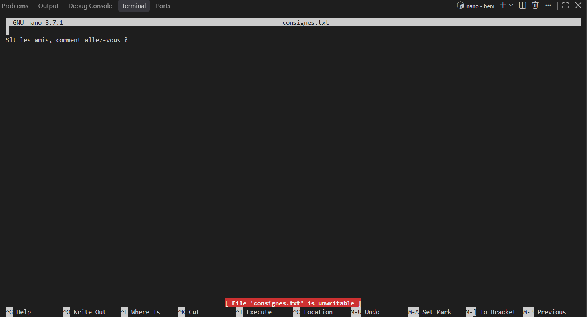

# File manipulation commands


## With the command ``mkdir`` :                
   I created the folders such as : 

  ```bash
    exercises then, entreprise 
    accounting,rh,computerScience                                                      # mkdir -p entreprises/{accounting,rh,computerScience}.txt
  ```

### Others small advanced tips with ``mkdir``
```bash
  mkdir week{1..8}                                                                        # creates week1 to week8 ({1..8} = nomber sequence)
  mkdir -p test/a/b/c        # dossiers imbriqués
  mkdir -p test/{x,y,z}      # dossiers côte à côte
```


## With the command ``touch``, 
I created in folder ``computerScience`` the files ``.txt`` such as :
  ```bash
  development.txt, devops.txt, ia.txt                                                     # touch file.txt
  ```

### Others small advanced tips with ``touch``
```bash
  touch rapport_{mondy,tuesday,wednesday}.txt                                             # one-click file creation
  touch test/.secret                                                                      # un fichier caché (le point au début)
```
  


## With the command `mv` :
I modified the file 
```bash
  ia.txt in science_of_ia.txt                                                             # mv file.txt new_file.txt
  Still using mv I moved the file devops.txt in folder rh                                 # mv devops.txt ../rh/
```

### Others small advanced tips with ``mv``
```bash
  mv rapport.txt ../rh/rapport_2026.txt                                                 # move et modify
  mv fichier1.txt fichier2.txt ../rh/                                                   # plusieurs fichiers vers un dossier
  mv *.txt ../rh/                                                                       # tous les .txt du dossier actuel
```


  > [!WARNING]
  > `mv` écrase sans prévenir un fichier qui porte déjà le même nom dans la destination.\
  > Ajoutez `-i` (*interactive*) pour que `mv` demande confirmation avant d'écraser :
  
  ```bash
         mv -i rapport.txt ../rh/
  ```


## With the command ``rm``
I removed the file 
``` bash
    development.txt                                                                        # supprimer un fichier 
```

### Others small advanced tips with ``rm`` 
```bash
  rm fichier1.txt fichier2.txt                                                             # supprimer plusieurs fichiers
  rm *.log                                                                                 # supprimer tous les fichiers .log du dossier
  rmdir dossier                                                                            # supprimer un dossier VIDE uniquement
  rm -r dossier                                                                            # supprimer un dossier ET tout son contenu (-r = récursif)

```
### Options utiles
> [!TIP]
> `i`	Demande confirmation pour chaque fichier. C’est la plus sûre.\
> `I`	Demande une seule confirmation si vous supprimez plus de 3 fichiers ou un dossier. C’est un bon compromis.\
> `v`	Affiche chaque fichier supprimé (verbose). On voit ce qui se passe.\
> `r`	Supprime les dossiers et leur contenu.\
> `f`	Force : aucune question, aucun message d’erreur.

### Les astuces de prudence

```bash
  1 Vérifier avant de supprimer.  
    ls *.log                                                                               # d'abord, voir ce qui correspond
    rm *.log                                                                               # ensuite, supprimer 
  2 Supprimer un fichier dont le nom commence par un tiret. Un fichier nommé -test.txt est pris pour une option. Ajoutez --, qui signifie « fin des options » :                                                           # rm -- -test.txt

  3 Supprimer un nom avec des espaces :                                                    # rm "mon fichier.txt"  
```

## Les dangers à connaître absolument
> [!CAUTION]
>`rm -rf`  supprime tout, sans aucune question. Utilisez-le seulement quand vous êtes certain de la cible, et relisez la commande avant d’appuyer sur Entrée.

```bash
        rm -rf ./dossier                                                                    # supprime "dossier" ✅
        rm -rf . /dossier                                                                   # supprime TOUT le dossier actuel ❌ (un espace en trop !).
        rm -rf "$DOSSIER"/*
        
```

# User creation and rights restriction commands

Pour l'occation, j'ai crée un dossir `partage` dans le repertoire `/srv` pour pouvoir faire intervenir les notions de proprietairs.
```bash
    sudo mkdir /srv/partage 
```

Puis, j'ai crée dans le dossier `partage` un fichier .txt : `consignes.txt` dont j'ai pu éditer avec la commande :
```bash
    sudo nano /srv/partage/consignes.txt
```  

Afin de pouvoir mettre les droits sur le dossier ainsi que le fichier , j'ai crée groupe utilisateur :
```bash
    sudo groupadd partage                                                                   # Commande pour créer utilisateur (attention, ce n'est pas un dossier, plutôt un fichier sys qui se retrouve dans le repertoire /etc/).
```
Dans lequel j'ai mis mon utilisateur `tarinee` via la commande :
```bash
    sudo usermod -aG partage trainee
```
Que j'ai crée avec la commande :
```bash
      sudo adduser trainee                                                                   # Commande pour ajouter un utilisateur.
```

Et j'y ai mis des droits de `lecture` et de `d'execution` en donnant au groupe `partage`le dossier `partage` qui se trouve dans `/srv`, ainsi que le fichier qui s'y trouve :
```bash
    sudo chown root:partage /srv/partage
    sudo chown root:partage /srv/partage/consigne.txt
```
Voici les droits en question :
```bash
    sudo chmod 750 /srv/partage                                                              # pour le groupe partage, j'ai mis sur le dossier des droits de lecture et d'exécution.
    sudo chmod 640 /srv/partage/consigne.txt                                                 # pour le groupe partage, j'ai mis sur le fichier des droits de lecture uniquement.
```

### Bon à savoir
Faut toujours se poser les questions suivantes avant d'agire :

> [!TIP]
> Dans quelle catégorie tombe votre nouveau utilisateur (propriétaire, groupe ou autres) ?\
> Quels droits cette catégorie doit avoir sur le dossier (pour entrer) ?\
> Et sur le fichier (pour lire sans modifier) ?

Pour tester la restriction, on passe en mode `trainee`, un des utilisateurs s'il y en a d'autre dans l'groupe `partage`
```bash
  su - trainee                                                                               # commande pour switch à un autre utilisateur (exit pour revenir).
```

! Test : Sur l'image on voit la prise de main du tarinee et son accès dossier partage qui la proprieté du root (images/connexion_acces.png)





## Other useful commands and advanced tips

```bash   
  pwd                                                                                        # où suis-je ?
  ls -la                                                                                     # lister, y compris les fichiers cachés, avec les détails
  ls -l                                                                                      # lister les fichier cahi
  ls -a test                                                                                 # .secret apparaît∟
  cd / cd .. / cd ~                                                                          # se déplacer
  touch fichier.txt                                                                          # créer un fichier vide
  cp / mv / rm                                                                               # copier / déplacer ou renommer / supprimer
  cat / less / head / tail                                                                   # lire un fichier (less : q pour quitter)
  find ~ -name "*.txt"                                                                       # chercher des fichiers
  grep "mot" fichier.txt                                                                     # chercher du texte dans un fichier
  sudo setfacl -m u:trainee:r /srv/partage/consigne.txt                                      # pour donner des droits à un seul utilisateur. 
```